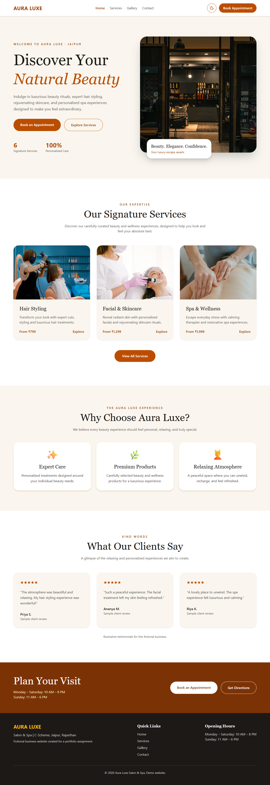
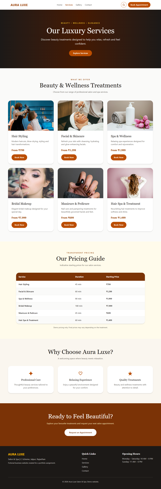
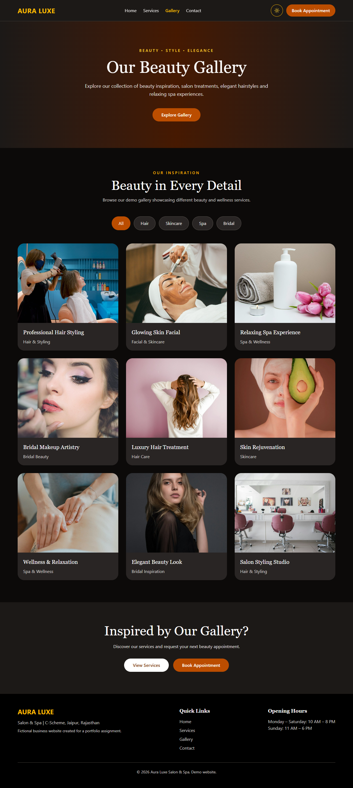
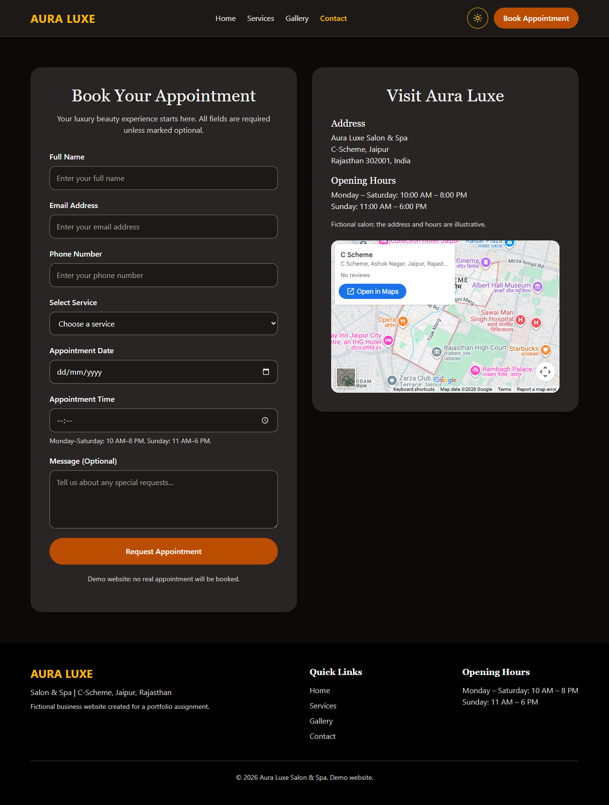
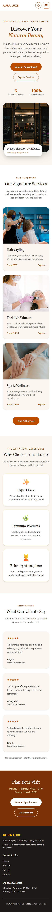
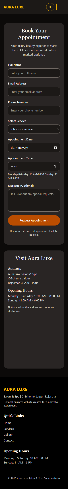

# Aura Luxe Salon & Spa

A responsive, accessible four-page website for Aura Luxe, a fictional premium salon and spa in Jaipur. It was built for Milestone 1 (Web Foundation) of the Full Stack + AI Engineering Program, under Option A: Local Business Website.

**Live site:** https://aura-luxe-salon-ebon.vercel.app

## Pages

| Page | File | What's on it |
| --- | --- | --- |
| Home | `index.html` | Hero, highlights, signature services, "Why choose us", testimonials, business hours |
| Services | `services.html` | Six service cards, pricing table, "Why choose us", call to action |
| Gallery | `gallery.html` | Responsive image grid with category filters and an image preview |
| Contact | `contact.html` | Accessible appointment form, address, opening hours, map embed |

## Tech used

- HTML5 with semantic elements
- Tailwind CSS v4, built with the Tailwind CLI
- A small amount of plain JavaScript, with no frameworks
- Git and GitHub for version control
- Vercel for deployment

## Features

- **Responsive, mobile-first layouts** tested at 320, 375, 768, 1024 and 1280px with no horizontal scroll
- **Dark mode** that follows the system setting by default, and remembers the visitor's choice across pages once they use the toggle
- **CSS Grid** for two-dimensional layouts: service cards, gallery, testimonials and the contact page columns
- **Flexbox** for one-directional layouts: navigation, "Why choose us", hero buttons and the footer
- **Accessibility:** a label on every form field, meaningful alt text, one `h1` per page, a skip link, visible keyboard focus and support for reduced motion
- **Form checks:** appointment times are checked against opening hours for the chosen day

The form is a demo and doesn't send data anywhere. The business, address, prices and testimonials are illustrative.

## Screenshots

### Desktop





### Dark mode





### Mobile

 

## Project structure

```text
├── index.html, services.html, gallery.html, contact.html
├── images/            Site photos and favicon
├── screenshots/       Images used in this README
└── src/
    ├── input.css      Tailwind entry file (edit this one)
    ├── output.css     Generated by Tailwind (do not edit)
    ├── theme.js       Applies the saved theme before the page paints
    ├── main.js        Mobile menu and dark mode button, used on every page
    ├── gallery.js     Gallery filters and image preview
    └── contact.js     Appointment form checks
```

## Run it locally

```bash
npm install
npm run dev
```

`npm run dev` rebuilds the CSS whenever a file changes. Open `index.html` in a browser to view the site. Use `npm run build` to create the minified CSS.

## Image credits

Stock photography, including images from [Unsplash](https://unsplash.com), used for demonstration only.
